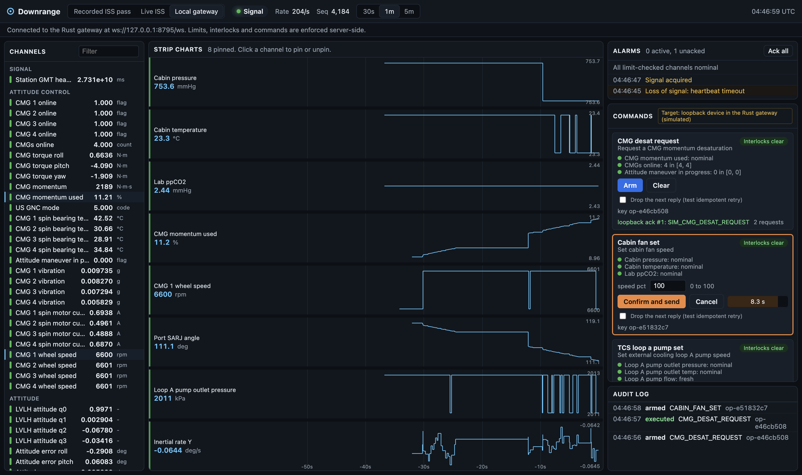

# Downrange

[](https://github.com/Mohith26/downrange/actions/workflows/ci.yml)

**Live demo:** https://mohith26.github.io/downrange/ (replays a recorded ISS session, or streams the live ISS feed straight into your browser)

Downrange is a mission-control style console for watching telemetry from real hardware and sending commands to it safely. I built it on NASA's public International Space Station telemetry feed, so the data on screen is real: cabin pressure, CO2, control moment gyroscope wheel speeds and vibration, solar array joint angles, cooling loop pressures, and the station clock that tells you whether the ground has signal.

It has three parts:

- **A Rust gateway** that connects to the ISS feed, records every update so a session can be replayed, checks every channel against limits, notices when data goes stale or the station drops out of contact, and fans the stream out to any number of browsers over WebSockets without letting a slow browser slow down anything else.
- **A guarded command path.** Commands have to be armed and then confirmed with a single-use token that expires, retries are safe because every request carries an idempotency key, and a command is refused if any telemetry it depends on is stale or out of limits. Everything lands in an audit log.
- **A React + TypeScript console** with canvas strip charts, an alarm panel, signal and staleness indicators, and a command panel whose buttons are driven by the live interlock state.

There is no real actuator behind the commands. They go to a loopback device that is clearly labeled as simulated everywhere it appears. The point is the safety semantics, which I test and count.



## Try it

Hosted (free, no server): https://mohith26.github.io/downrange/

- **Recorded ISS pass** replays a 77.9 minute session I recorded from the live feed on 2026-11-12 03:23 UTC, at 1x to 60x.
- **Live ISS** opens a WebSocket from your browser directly to NASA's Lightstreamer server.
- Commands in the hosted build run against an in-browser twin of the gateway's command engine (same rules, also a loopback target).

Local, with the Rust gateway:

```bash
./run.sh            # live ISS through the gateway, recorded to recordings/
./run.sh replay 10  # replay the bundled session at 10x
./run.sh synth      # synthetic load (benchmark data, not telemetry)
# open http://127.0.0.1:8787, stop with: curl -X POST http://127.0.0.1:8787/shutdown
```

Needs Rust (stable) and Node 22+.

## Design

```
 NASA ISSLIVE (Lightstreamer, TLCP over HTTP streaming)
        |
        v
 +---------------- gateway (Rust, tokio) -----------------+
 | iss.rs     raw TLCP client, MERGE state, reconnect      |
 | record.rs  append-only session log  -> replay           |
 | limits.rs  hysteresis limits, staleness, LOS            |
 | hub.rs     seq numbers, ring buffer, per-client queues  |
 | command.rs arm/confirm tokens, idempotency, interlocks  |
 | app.rs     HTTP + WebSocket server                      |
 +--------------------------------------------------------+
        |  WebSocket (JSON frames)
        v
 console (React + TypeScript, canvas charts)
```

**Ingest.** I talk TLCP-2.2.0 directly over a plain TCP socket instead of using the vendor SDK. The client handles chunked streaming, applies MERGE deltas (empty field means unchanged, `^N` means N unchanged fields), reconnects with exponential backoff, and treats 20 seconds of silence as a dead stream. ISS channels only publish when a value changes, so a channel that has not updated in minutes is not necessarily stale. Liveness comes from the station clock channel `TIME_000001`, which ticks several times a second while there is signal, plus each item's `Status.Class` (24 means signal; the ISS-Mimic project uses the same rule). Ten seconds without a heartbeat, or a non-24 status, puts the whole console into LOS and every interlock that needs fresh data fails closed.

**Limits.** Each channel can have low/high warning and alarm thresholds with hysteresis: escalation is immediate, but a value has to come back inside a threshold by the hysteresis margin before the state clears, so a value sitting on a line does not chatter. The thresholds are mine, chosen to bracket the nominal values I observed in the feed. They are not NASA flight rules.

**Fan-out.** Every sample gets a sequence number. A batch is serialized to JSON once and the same bytes are shared by every client. Each client has a bounded queue. If a client falls behind and its queue is full, the gateway stops queueing for it and keeps only the latest value per channel, then sends one coalesced frame when the client catches up. Ingest never waits on a socket. A ring buffer of recent frames lets a client that reconnects say "resume from seq N" and get exactly what it missed, or a snapshot if N is too old.

**Commands.** Arm validates the command and arguments, evaluates the interlocks against live telemetry, and returns a 128-bit random token that expires in 10 seconds. Confirm must present that token with the same idempotency key, re-checks the interlocks, and executes at most once. A retried arm returns the same token, a retried confirm returns the original result marked as deduplicated, and a reused or expired token is rejected. Every step is appended to `audit.jsonl` and broadcast to the console. The ISS command list lives in `channels/iss_commands.json` and is shared by the gateway and the browser.

**Console.** Telemetry goes into fixed-size typed-array ring buffers outside React. The strip charts draw on one canvas every animation frame and reduce each lane to one min/max column per pixel, so drawing cost depends on lanes times width, not on the sample rate. React panels re-render four times a second. The WebSocket client reconnects with backoff, resumes from its last sequence number and drops any overlap.

**Channels.** 90 public ISS channels with a description and unit for each, taken from the ISS-Mimic project's public telemetry list (`Telemetry/ISS_Public_Telemetry.xlsx` in github.com/ISS-Mimic/Mimic). Where that sheet's unit column disagreed with the description and with the values in the feed (for example cabin pressure reads about 754, which is mmHg, not psi), I used the unit the data supports; the sheet's original unit is kept in `source_unit_column`.

## Measured results

All numbers come from `results/results.json`, written by `scripts/bench.sh` on arm64 macOS 27.2 (18 logical CPUs). The gateway and every benchmark client run on the same machine over loopback.

**Recorded ISS session** (real data, `iss_session`)

| | |
|---|---|
| Minutes recorded | 77.9 |
| Channels subscribed / with updates | 90 / 90 |
| Updates received | 157,288 |
| Loss-of-signal events detected | 23 (21 heartbeat timeout, 2 source reports loss of signal) |
| Seconds spent in LOS | 1287 |
| Feed reconnects | 4 |
| Limit transitions | 0 |

**Fan-out under synthetic load** (`fanout_throughput`, the generator exists only for this)

| Channels x Hz | Samples/s offered | Clients | Ingest stalls | p50 latency | p99 latency | Pass |
|---|---|---|---|---|---|---|
| 1,000 x 100 | 100,000 | 4 | 0 | 0.127 ms | 0.252 ms | yes |
| 2,000 x 250 | 500,000 | 4 | 0 | 0.383 ms | 0.673 ms | yes |
| 4,000 x 500 | 2,000,000 | 4 | 0 | 1.391 ms | 59.209 ms | yes |
| 8,000 x 500 | 4,000,000 | 4 | 63 | 1501.08 ms | 4391.64 ms | no |

Highest passing point: **2,000,000 samples/s** (4,000 channels x 500 Hz) to 4 WebSocket clients with 0 ingest stalls, p50 1.391 ms and p99 59.209 ms from ingest to client receive. A point passes only with 0 ingest stalls, 0 coalesced frames, 0 sequence gaps and every client receiving at least 98% of the offered rate. Latency is measured from the moment the generator stamps a batch to the moment a client has parsed it.

**One stalled client** (`slow_client`, 1,000 channels x 100 Hz, 3 fast clients, 20 s)

| | No stalled client | One stalled client |
|---|---|---|
| Fast clients p50 / p99 latency | 0.127 / 0.219 ms | 0.129 / 0.211 ms |
| Fast clients sequence gaps | 0 | 0 |
| Ingest stalls | 0 | 0 |
| Stalled client max queued samples (cap 20,000) | n/a | 19,779 |
| Samples coalesced away for the stalled client | n/a | 2,066,477 |
| Process RSS during run | 14.9 to 28 MB | 38.9 to 44.7 MB |

The stalled client's queue sits at its cap from the first second on, and memory stays flat (the per-second timeline is in the results file) even though the gateway keeps producing 100,000 samples per second that the client never reads. RSS is for the whole benchmark process, which also hosts the client sockets.

**Command faults** (`command_faults`, 1,000 commands over real WebSockets)

Injected: 198 lost arm replies, 215 lost confirm replies, 200 duplicate confirms, 155 reconnects between arm and confirm, 82 interlock breaches. Result: **1,000 of 1,000 commands executed exactly once**, 0 executed twice, 0 never executed, 82 interlock rejections, 415 retries answered from the dedup table instead of executing.

**Browser rendering** (`browser_render`, Chromium tab at 1440x900 on a 120 Hz display, gateway streaming synthetic channels into the console's own `?bench=1` mode, which measures `requestAnimationFrame` intervals for 10 s and posts them back to the gateway)

| Lanes | Samples/s into the page | Avg fps | p95 frame | p99 frame | Frames over 33 ms |
|---|---|---|---|---|---|
| 128 | 6,400 | 120.1 | 9.2 ms | 9.4 ms | 0 of 1199 |
| 64 | 6,398 | 120.0 | 9.3 ms | 9.4 ms | 0 of 1200 |

## Tests

- `cd gateway && cargo test --release`: TLCP parsing and MERGE state, recorder round trip, hysteresis and LOS logic, token expiry and reuse, interlock re-check at confirm, hub coalescing and resume, and integration tests over real WebSockets (the command fault run, reconnect-resume without gaps, a stalled client staying bounded, LOS counting from a recording).
- `cd console && npm test`: TLCP parser, limits, ring buffer and decimation, the command flow with a lost reply and retry, and the WebSocket client's resume logic.
- CI runs both on every push.

## Caveats

- **The actuator is simulated.** Commands go to a loopback device in the gateway (or an in-browser twin in the hosted demo). Nothing is sent to the ISS, and the command names are prefixed `SIM_`.
- **Benchmarks use synthetic load.** The ISS feed is slow (tens of updates per second across all channels), so throughput, stalled-client and render numbers come from a synthetic generator. Only the session statistics use ISS data.
- **Run-to-run variance.** These numbers are from one run on a laptop that was doing other work. My first full run, with a browser tab rendering live charts at the same time, only passed up to 500,000 samples/s; I re-ran the server benchmarks with the browser idle and this README reports that second run. The p99 at the 2,000,000 samples/s point is much higher than its p50, which tells me that point is near the edge on this machine.
- **Single machine.** Gateway and clients share one machine and talk over loopback, so the latency numbers leave out real network time.
- **Limits are mine.** Thresholds bracket observed nominal values; they are not NASA flight rules or crew safety limits.
- **Public feed limits.** The ISSLIVE feed is a public demo server. It drops streams, has gaps, and some channels arrive flagged with a non-signal status. The recorded session includes 4 feed reconnects, and I count heartbeat gaps of more than 10 seconds as loss of signal, which is a conservative choice.
- **Units.** A few units in the public channel list are ambiguous; see the Channels note above.

## Credits

ISS telemetry: NASA's public ISSLIVE Lightstreamer feed. Channel descriptions: the ISS-Mimic open source project.
